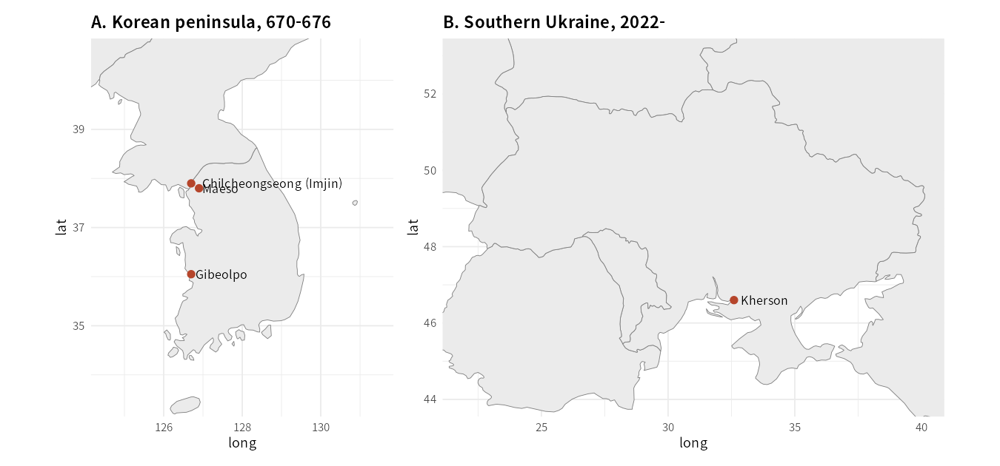

```{=html}
<style>
.cell-output-display img, figure img, .quarto-figure img { max-width:100% !important; height:auto !important; }
@media (max-width:640px){ .cell-output-display img, figure img { width:100%; } .figure-caption, figcaption { font-size:.82rem; } }
</style>
```

::: {.callout-note}
## 핵심 문장

신라본기 교전 기사 205건 가운데 절반(50%)이 6–9월에 있었다. 몬순기에 공세를 피했다는 흔적은 사료에 없다. 사료에서 드물게 나타나는 달은 11–12월(4%)이다. 다만 이 결핍은 월 표기를 한 달 옮기면 사라진다. 670–676년 기록에서 기후 때문에 작전이 멈췄다고 적힌 기사도 없다. 그런 기록은 662년 평양 보급 실패 하나뿐이다. **사료는 "몬순이 공세를 막았다"는 가설을 지지하지 않는다. 그렇다고 몬순이 영향이 없었다는 증거도 아니다. 사료는 편집된 기록이기 때문이다.**
:::

::: {.callout-warning}
## 정정 (2026-10-25)

직전 수정본은 다음 두 가지를 틀리게 썼다. 철회한다.

- **서울 1981–2010년 평년 강수와 교전 달을 맞춘 이항검정(p = 1.00).** 7세기 강수를 현대 평년으로 대신할 수 없다. 시대착오다. 이 글은 이 검정을 버리고, 사료 자체의 달 분포로 검정을 다시 했다.
- 초판의 "신라-당 교전 13건 가운데 77%가 6–9월"은 월 미기재 기사를 센 오류였다. 원문에서 월이 확인되는 육전·해전 기사는 8건이고, 그중 5건(62%)이 6–9월이다. 이 표본은 무작위 배치와 구별되지 않는다(아래 연표 다음 문단).

그 밖의 정정은 유지한다. 안승 책봉은 7월이 아니라 8월(冊文의 "秋八月")이다. 672년 8월 기사는 당군이 아니라 고구려군과의 교전이었고 신라군이 석문에서 패했다.
:::

```{python}
#| label: setup
import json, statistics as st, calendar
from pathlib import Path
from collections import defaultdict, Counter
from math import comb
import numpy as np
import matplotlib.pyplot as plt

plt.rcParams["font.family"] = "Noto Sans CJK KR"
plt.rcParams["axes.unicode_minus"] = False
plt.rcParams["figure.dpi"] = 130
BLUE, GREEN, RED, GOLD, MUTED = "#38bdf8", "#22c55e", "#ef4444", "#f59e0b", "#64748b"

def finish(ax, title, sub=""):
    ax.set_title(title, fontsize=13, fontweight="bold", loc="left", pad=24 if sub else 14)
    if sub:
        ax.text(0, 1.02, sub, transform=ax.transAxes, fontsize=9.5, color=MUTED, va="bottom")
    ax.spines[["top", "right"]].set_visible(False)

MONTHS = [f"{m}월" for m in range(1, 13)]
```

# 질문: 7세기의 기후를 무엇으로 알 수 있는가

공세가 몬순 때문에 멈췄는지 묻는 질문은 기후와 분쟁을 잇는 연구의 질문과 같다. 그 연구들은 주로 현대의 관측 자료에 기댄다(Buhaug 2010; Hsiang et al. 2013; Mach et al. 2019). 670년대 한반도에는 관측 자료가 없다. 근대적 관측은 20세기 초 이후에 시작되었다. 그래서 이 글은 현대 평년 강수를 7세기의 기후로 쓰지 않는다.

남는 자료는 사료 자체다. 『삼국사기』 신라본기는 교전, 재해, 천문을 날짜와 함께 기록했다. 이 글은 그 기록의 달만 쓴다.

- **교전 기사**: 주제 분류가 "정치＞군사＞전쟁"으로 시작하고 월이 적힌 기사. `{python} "205"`건.
- **재해·기후 기사**: 주제 분류가 "재해"이거나 "자연현상＞기후"이며 월이 적힌 기사. `{python} "239"`건.

두 집합 모두 국사편찬위원회 한국사데이터베이스의 『삼국사기』 원문 XML에서 뽑았다. 추출 코드는 `tools/sp44_extract_samguk.py`에 있다. 뽑은 결과는 `data/sp44_silla_months.json`에 있다.

역법 문제가 있다. 신라본기 문무왕 14년(674) 정월에 "傳學曆術還, 改用新曆法"이라는 기사가 있다. 당에서 배운 역법을 쓰기 시작했다는 뜻이다. 따라서 그 전후의 월 대응은 한 달쯤 어긋날 수 있다. 아래에서 월을 ±1개월 옮긴 민감도 검정을 함께 한다.

# 670–676년 교전 연표

아래 표는 『삼국사기』 문무왕 10–16년(670–676) 기사에서 옮겼다. 문무왕은 661년에 즉위했으므로 연차에 660을 더해 서기 연도로 바꿨다. 월이 적히지 않은 기사는 "미기재"로 두었다.

| 연도 | 월 | 사건 | 주도 | 결과 |
|---|---|---|---|---|
| 670 | 8 | 안승 책봉 (정치) | 신라 | — |
| 671 | 6 | 석성 전투, 당군과 교전 | 신라 | 기록상 5,300급 참수 |
| 671 | 9 | 당 장수 고간 등이 대방을 침입 | 당 | 침입 |
| 671 | 10 (6일) | 당 조운선 70여 척 공격 | 신라 | 결과 미기재 |
| 672 | 7 | 당 장수가 평양에 군영 8곳 설치 | 당 | 전개 |
| 672 | 8 | 고구려군과 교전, 석문까지 추격당함 | 고구려 | **신라군 패전** |
| 673 | 미기재 | 당·말갈·거란과 아홉 번 교전 | 신라 | 9회 모두 승리로 기록 |
| 674 | 1–2 (추정) | 당이 김인문을 신라왕으로 책봉 (정치) | 당 | — |
| 675 | 2 | 칠중성에서 유인궤가 신라군 격파 | 당 | **신라군 패전** |
| 675 | 9 | 천성에서 설인귀를 격파 | 신라 | 참수 1,400급 |
| 675 | 9 (29일) | 매소성에서 이근행을 격파 | 신라 | 전마 30,380필 획득 |
| 675 | 미기재 | 당·거란·말갈군이 칠중성을 포위 | 당 | 함락 실패 |
| 675 | 미기재 | 석현성 함락 | 당 | 함락 |
| 676 | 7 | 도림성 공격 | 당 | 함락 |
| 676 | 11 | 기벌포에서 설인귀에게 패함 | 당 | **신라군 패전** |
| 676 | 11 | 기벌포 패전 뒤 22회 교전 | 신라 | 승리로 기록, 전장 미상 |

월이 확인되는 육전·해전 기사는 8건이다. 그 가운데 6–9월에 있는 것이 5건(62%)이다. 6–9월은 12달 중 4달이므로 무작위라면 기대 비율은 1/3이다. 이항검정 단측 p = 0.09로, 이 표본은 무작위 배치와 구별되지 않는다. 표본이 작아 검정력이 낮으므로 이 8건만으로는 결론을 낼 수 없다. 그래서 아래에서는 신라본기 전체 기사로 분포를 본다.

# 신라본기의 달: 교전과 재해

```{python}
#| label: silla-stats
#| fig-cap: "그림 1. 신라본기 기사의 음력 월 분포. 금색은 교전 기사(월이 적힌 것 205건), 파란색은 재해·기후 기사(239건)의 달별 비중이다. 점선은 균등 분포(1/12). 출처: 『삼국사기』 신라본기 권1–12 원문 XML(국사편찬위원회), 추출 코드 tools/sp44_extract_samguk.py."
SIL =json.loads(Path("data/sp44_silla_months.json").read_text())["records"]

def dist(kind, shift=0):
    months = [((r["month"] - 1 + shift) % 12) + 1 for r in SIL if r["kind"] == kind]
    c = Counter(months)
    return [c.get(m, 0) for m in range(1, 13)], len(months)

def p_hi(n, k, p):
    return sum(comb(n, i) * p**i * (1 - p)**(n - i) for i in range(k, n + 1))

def p_lo(n, k, p):
    return sum(comb(n, i) * p**i * (1 - p)**(n - i) for i in range(0, k + 1))

def fp(v):
    return "p < 0.001" if v < 0.001 else f"p = {v:.3f}"

SUMMER, LATE, SPRING = (6, 7, 8, 9), (11, 12), (3, 4, 5)
WC, NW = dist("war")
XC, NX = dist("weather")
share = lambda cnt, n, ms: sum(cnt[m - 1] for m in ms) / n

ws, wl = share(WC, NW, SUMMER), share(WC, NW, LATE)
xs, xsp = share(XC, NX, SUMMER), share(XC, NX, SPRING)
k_ws, k_wl = round(ws * NW), round(wl * NW)
p_summer = p_hi(NW, k_ws, 4 / 12)   # 교전이 6–9월에 몰린 정도 (균등 1/3 기준, 상측)
p_late = p_lo(NW, k_wl, 2 / 12)     # 11–12월에 적게 있는 정도 (균등 1/6 기준, 하측)
p_xsum = p_lo(NX, round(xs * NX), 4 / 12)

# 월 표기 ±1개월 민감도
w_m1, _ = dist("war", -1)
w_p1, _ = dist("war", +1)
sens = {
    "-1": (share(w_m1, NW, SUMMER), share(w_m1, NW, LATE)),
    "+1": (share(w_p1, NW, SUMMER), share(w_p1, NW, LATE)),
}
p_late_p1 = p_lo(NW, round(sens["+1"][1] * NW), 2 / 12)
p_summer_p1 = p_hi(NW, round(sens["+1"][0] * NW), 4 / 12)

# 661년 전후 분할
pre = [r for r in SIL if r["kind"] == "war" and int(r["file"][3:6]) <= 5]
post = [r for r in SIL if r["kind"] == "war" and int(r["file"][3:6]) > 5]
pre_s = sum(1 for r in pre if r["month"] in SUMMER) / len(pre)
post_s = sum(1 for r in post if r["month"] in SUMMER) / len(post)

fig, ax = plt.subplots(figsize=(7.2, 3.8))
x = np.arange(1, 13)
ax.bar(x - 0.2, np.array(WC) / NW, width=0.38, color=GOLD, label=f"교전 기사 (n={NW})")
ax.bar(x + 0.2, np.array(XC) / NX, width=0.38, color=BLUE, alpha=0.85, label=f"재해·기후 기사 (n={NX})")
ax.axhline(1 / 12, color=MUTED, lw=1, ls="--")
ax.text(12.6, 1 / 12, "균등 1/12", fontsize=8, color=MUTED, va="center")
ax.set_xticks(x)
ax.set_xticklabels(MONTHS, fontsize=8)
ax.set_ylabel("달별 비중")
ax.yaxis.set_major_formatter(lambda v, _: f"{v:.0%}")
ax.legend(frameon=False, fontsize=8.5, loc="upper left")
finish(ax, "신라본기 기사의 음력 월 분포 (권1–12)", f"교전은 7–9월, 재해는 3–5월에 몰린다")
fig.tight_layout()
plt.show()
```

교전 기사 `{python} f"{NW}"`건 가운데 6–9월은 `{python} f"{ws:.0%}"`다. 균등 분포라면 1/3이다. 6–9월이 그보다 많다는 것은 `{python} fp(p_summer)`이다. 11–12월은 `{python} f"{wl:.0%}"`에 불과하다. 균등이면 1/6이다. 11–12월이 적다는 것은 `{python} fp(p_late)`다.

재해·기후 기사는 3–5월에 `{python} f"{xsp:.0%}"`가 몰린다. 6–9월은 `{python} f"{xs:.0%}"`뿐이다. 여름 강우가 가장 많은 시기에 재해 기록이 가장 적다. 기록이 가뭄과 봄철 재해에 치우쳐 있을 가능성이 있다.

이 결과는 두 가지 방식으로 확인했다.

- **시기 분할.** 661년 이전(권1–5)과 이후(권6–12)를 나눠도 교전 기사의 6–9월 비중은 `{python} f"{pre_s:.0%}"`와 `{python} f"{post_s:.0%}"`로 같다. 시기가 달라도 같은 패턴이다.
- **월 표기 민감도.** 모든 월을 한 달 앞으로 옮기면(−1) 6–9월 비중은 `{python} f"{sens['-1'][0]:.0%}"`, 11–12월은 `{python} f"{sens['-1'][1]:.0%}"`다. 한 달 뒤로 옮기면(+1) 6–9월은 `{python} f"{sens['+1'][0]:.0%}"`, 11–12월은 `{python} f"{sens['+1'][1]:.0%}"`가 된다. 이때 11–12월 결핍은 `{python} fp(p_late_p1)`로 유의하지 않다. 6–9월 집중은 `{python} fp(p_summer_p1)`로 남는다.

## 가설을 어떻게 시험하나

몬순 가설은 "몬순기에는 공세가 줄어든다"는 예측을 한다. 사료는 반대로 나온다. 교전은 6–9월에 가장 많이 기록되었다. 이 가설은 사료에서 기각된다.

겨울 가설은 "겨울에는 공세가 줄어든다"는 예측을 한다. 사료에서 11–12월은 적지만 1–2월에는 교전 기사가 많다. 그래서 겨울 가설은 "11–12월의 결핍"이라는 좁은 형태로만 남고, 그 결핍도 월 표기에 따라 흔들린다.

사료의 달 분포는 세 가지 해석과 모두 맞는다. 추수 전후의 군량 사정, 몬순기의 이동 조건, 승리 기사 중심의 편집이다. 이 세 가지를 구별하는 기록은 이 자료에 없다.

# 662년 평양: 사료에 남은 기후와 보급의 사례

670–676년 구간에서 기후가 작전을 멈추게 한 기록은 찾지 못했다. 그 사례는 662년 평양 작전에 있다. 『삼국사기』 권7 문무왕 11년(671) 7월 26일 기사에 설인귀에게 보내는 문무왕의 답서가 실려 있다. 답서는 662년 정월의 사정을 이렇게 적었다.

> 至龍朔二年正月, 劉揔管共新羅兩河道揔管金庾信等, 同送平壤軍粮. 當時隂雨連月, 風雪極寒, 人馬凍死, 所將兵粮, 不能勝致. 平壤大軍又欲歸還, 新羅兵馬, 粮盡亦迴.

(용삭 2년 정월에 유인궤 총관과 신라의 양도 총관 김유신 등이 평양의 대군에 군량을 함께 보냈다. 그때 장맛비가 달을 잇고 눈보라가 몹시 차서 사람과 말이 얼어 죽었고, 실어 간 군량을 제대로 전하지 못했다. 평양의 대군도 돌아가려 했고 신라군도 군량이 떨어져 돌아왔다.)

『삼국유사』에도 같은 전투의 기사가 있다. 다만 당의 사서(唐史)를 인용한 주석이다. "遂圍平壤城會大雪解圍還"이라고 적혀 있다. 두 기록 모두 신라 왕의 서신이거나 당사의 인용이다. 교전 당사자 사이에서 교차 검증된 기록은 아니다. 그래도 기후와 보급이 함께 작전을 끊었다고 적은 기록은 이 두 개뿐이다.

662년은 정월이다. 신라본기 교전 기사의 달 분포에서 정월은 16건으로 평균 수준이다. 정월에 작전이 드물었다고 볼 근거는 없다. 이 사례는 "겨울이 작전을 막았다"는 일반 규칙이 아니라, 한 번의 기후 사고가 보급을 무너뜨린 사례다.

670–676년의 보급선 기록은 하나뿐이다. 671년 10월 신라군이 당의 조운선 70여 척을 공격했다. 결과는 기록되지 않았다. 676년 11월 기벌포 해전은 해상 보급과 관련되지만, 기록에 보급 차단이 원인이라고 적힌 것은 없다.

# 헤르손: 현대 사례는 사료가 아니다

2022년 이후 헤르손 전선은 같은 질문을 현대 자료로 던질 수 있는 사례다. 다만 여기서 쓰는 자료는 사료가 아니라 재분석 기후 자료와 보도다. 그래서 신라 사례와 같은 무게로 읽지 않는다.

```{python}
#| label: kherson-monthly
#| fig-cap: "그림 2. 헤르손(46.6°N, 32.6°E)의 월별 강수(막대, 평균)와 평균기온(선). 각 달은 완전한 달만 골라 해별로 평균했다(1–6월은 2022–2026년 5년, 7–12월은 2022–2025년 4년). 점은 중앙값이다. 출처: Open-Meteo Historical API(ERA5 계열 재분석), 2026-10-25 조회."
K = json.loads(Path("data/sp44_kherson_daily.json").read_text())["daily"]
ysum, ycnt, tmp = defaultdict(float), defaultdict(int), defaultdict(list)
for t, p, tm in zip(K["time"], K["precipitation_sum"], K["temperature_2m_mean"]):
    mo = int(t[5:7])
    ysum[(t[:4], mo)] += p or 0
    ycnt[(t[:4], mo)] += 1
    if tm is not None:
        tmp[mo].append(tm)
full = {k: v for k, v in ysum.items() if ycnt[k] == calendar.monthrange(int(k[0]), k[1])[1]}
per_mon = {mo: [v for (y, m), v in full.items() if m == mo] for mo in range(1, 13)}
prec = [st.mean(per_mon[mo]) for mo in range(1, 13)]
prec_med = [st.median(per_mon[mo]) for mo in range(1, 13)]
temp = [st.mean(tmp[mo]) for mo in range(1, 13)]
nov23 = full[("2023", 11)]

fig, ax = plt.subplots(figsize=(7.2, 3.6))
ax.bar(range(1, 13), prec, color=BLUE, width=0.7, label="강수 평균 (mm)")
ax.scatter(range(1, 13), prec_med, color=GOLD, s=28, zorder=4, label="강수 중앙값 (mm)")
ax2 = ax.twinx()
ax2.plot(range(1, 13), temp, color=RED, marker="o", lw=2, label="평균기온 (°C)")
ax.set_xticks(range(1, 13))
ax.set_xticklabels(MONTHS, fontsize=8)
ax.set_ylabel("월 강수량 (mm)")
ax2.set_ylabel("평균기온 (°C)")
ax2.spines[["top"]].set_visible(False)
ax.annotate(f"11월 평균 {prec[10]:.0f} mm\n중앙값 {prec_med[10]:.0f} mm", xy=(11, prec[10]), xytext=(7.6, 74),
            fontsize=8.5, arrowprops=dict(arrowstyle="-", color=MUTED))
ax.legend(frameon=False, fontsize=8, loc="upper left")
finish(ax, "헤르손: 월별 강수와 기온", "막대 = 평균, 점 = 중앙값, 선 = 기온")
fig.tight_layout()
plt.show()
```

11월의 월 강수 합계 평균은 `{python} f"{prec[10]:.1f}"` mm로 연중 가장 많다. 그러나 중앙값은 `{python} f"{prec_med[10]:.1f}"` mm로 10월과 같다. 평균을 끌어올린 것은 2023년 11월(`{python} f"{nov23:.1f}"` mm) 같은 많은 비가 내린 해다.

2022년 11월 드니프로 우안 철수는 보도 기준으로 11월 9일 무렵 발표되고 11일 무렵 완료가 주장되었다. 같은 기간의 재분석 강수는 달랐다. 11월 3일부터 15일까지 하루 강수가 모두 0 mm였다. 철수 날짜의 기상은 건조했다. 월평균이 높은 달이라는 사실은 이 철수의 원인이 되지 않는다.

# 지도

{#fig-map width=100%}

지도는 두 장소의 위치 관계만 보여준다. 헤르손의 전선은 그리지 않았다. 날짜별 전선 자료를 아직 코딩하지 않았고, 실시간 전황 지도의 재배포 조건도 확인하지 않았다.

# 사료가 말하는 것과 말하지 못하는 것

사료에서 확인되는 것은 네 가지다.

1. 670–676년에 기후가 작전을 멈추게 했다고 적힌 기사는 없다. 662년 평양의 보급 실패가 유일한 예외이며, 그 기사는 이 구간 밖에 있다.
2. 신라본기 교전 기사는 6–9월에 가장 많다. 몬순기에 공세를 피했다는 패턴은 사료에 없다.
3. 11–12월에는 교전 기사가 드물다. 다만 이 결핍은 월 표기를 한 달 옮기면 사라진다. 확정된 패턴이 아니다.
4. 재해 기사는 3–5월과 7월에 많고, 6–9월은 27%다. 여름 강우가 재해로 기록되는 경향은 약하다.

> **사료는 몬순이 공세를 막았다는 가설을 지지하지 않는다. 겨울 결핍은 월 표기에 따라 흔들린다. 662년의 기후–보급 사례는 한 번뿐이다.**

::: {.callout-warning}
## 반대 해석과 이 결론이 깨지는 조건

1. **승리 기사 편향.** 『삼국사기』는 국가 편찬물이다. 6–9월의 교전 기사 과잉이 실제 공세의 과잉인지, 승리를 기록하려는 편집인지 구별할 수 없다. 패전과 철수가 빠졌다면 달의 분포는 달라진다.
2. **기사 날짜는 보고 날짜일 수 있다.** 월이 적힌 기사는 전장에서 일어난 날이 아니라 보고된 달일 수 있다. 보고가 늦었다면 몬순기 교전이 다른 달로 옮겨진다.
3. **역법과 월 표기.** 674년 신력 채용 전후의 월 대응은 한 달쯤 어긋날 수 있다. 그 어긋남에 따라 겨울 결핍의 결론이 바뀐다. 6–9월 집중은 ±1개월 옮김에도 남았다.
4. **재해 기사의 선택.** 재해 기록은 가뭄과 지진에 치우쳐 있다. 여름 홍수가 적게 기록되었다면 몬순의 영향이 사료에서 과소평가된다.
5. **두 사례는 짝이 아니다.** 헤르손은 현대 재분석과 보도 자료에 기대고, 신라-당은 편집된 사료에 기댄다. 같은 무게로 비교할 수 없다. 공통 구조가 있다고 말하려면 같은 방식으로 코딩된 비교 집합이 필요하다.
6. **드론과 포병은 계절의 제약을 바꾼다.** 2022년 이후의 전장에서는 보급선이 계절과 무관하게 노출된다. 7세기의 구조가 현대에도 같다고 볼 수 없다.
:::

# 한계와 다음 단계

- **판본 대조.** 이 글은 국사편찬위원회 원문 XML을 썼다. 판본마다 글자가 다른 곳이 있다(예: 답서의 "隂"). 주석의 판본 차이는 정정 대상이 될 수 있다.
- **당 측 사서.** 『구당서』·『신당서』의 662년 기사는 이 글에서 인용하지 않았다. 원문을 대조하지 않았기 때문이다. 대조한 뒤 인용할 수 있다.
- **기후 재구성.** 7세기 강수를 재구성하는 자료는 이 글에서 찾지 못했다. 연륜, 퇴적물, 꽃가루 같은 대리 자료가 있다면 사료의 달 분포와 대조할 수 있다. 현대 관측 자료는 기준선으로 쓰지 않는다.
- **삼국유사.** 재이 기사를 아직 전수로 뽑지 않았다. 기이편의 천문·기상 기사를 같은 방식으로 추가해야 한다.
- **비교 집합.** 수 양제의 고구려 원정(612), 1812년 나폴레옹의 러시아 원정, 1941년 독일의 소련 침공을 같은 방식으로 코딩해야 한다. 지금은 사례가 두 개뿐이다.
- **헤르손 날짜.** 2022년 11월 철수와 2023년 6월 카호우카 댐 붕괴의 날짜는 공개 보고서로 확인해야 한다. 이 글은 보도 기준 날짜를 쓰되, 확정된 날짜로 쓰지 않았다.

# 참고 문헌

- Buhaug, H. (2010). Climate not to blame for African civil wars. *PNAS*, 107(38), 16477–16482.
- Hsiang, S. M., Burke, M., & Miguel, E. (2013). Quantifying the influence of climate on human conflict. *Science*, 341(6151), 1235367.
- Mach, K. J. et al. (2019). Climate as a risk factor for armed conflict. *Nature*, 571, 193–197.
- van Creveld, M. (1977). *Supplying War: Logistics from Wallenstein to Patton*. Cambridge University Press.
- 김부식 (1145). 『삼국사기』 신라본기 권1–12. 국사편찬위원회 한국사데이터베이스 원문 XML(문무왕 본기 권6–7 포함, 답설인귀서 권7 문무왕 11년 7월 26일 기사).
- 일연 (1281년경). 『삼국유사』 기이편 소정방 기사(당사문 인용 주).
- Open-Meteo. Historical Weather API (ERA5 계열 재분석). 2026-10-25 조회.
