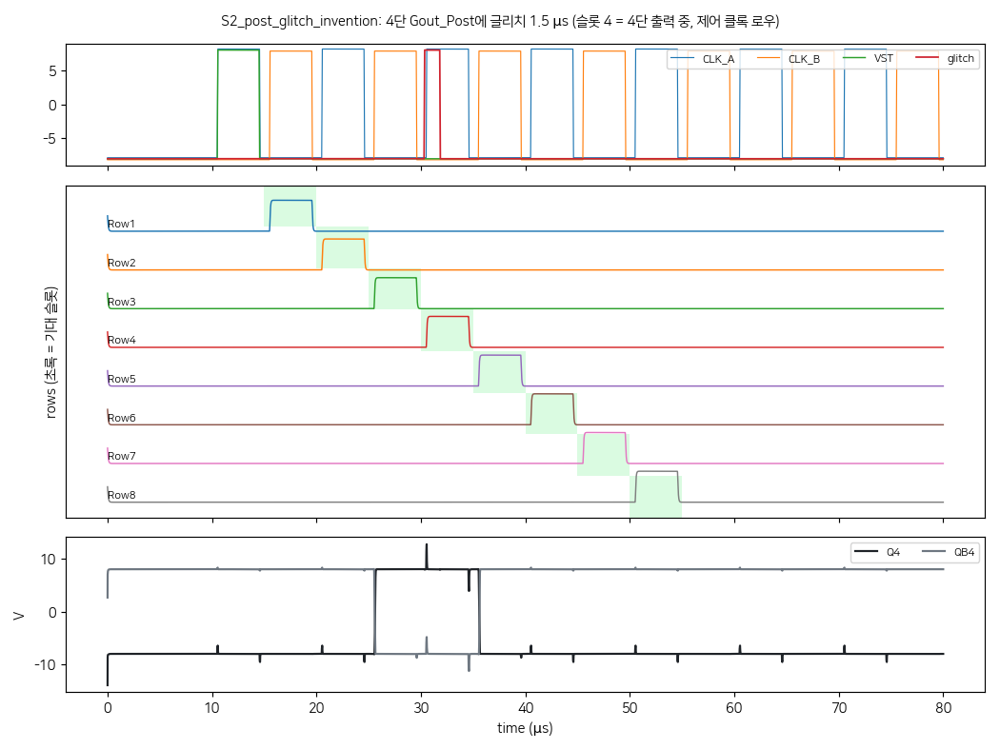
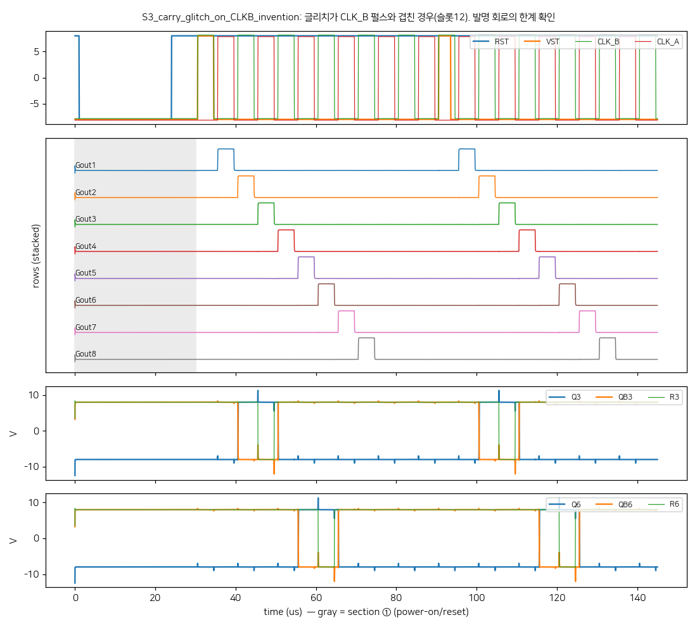
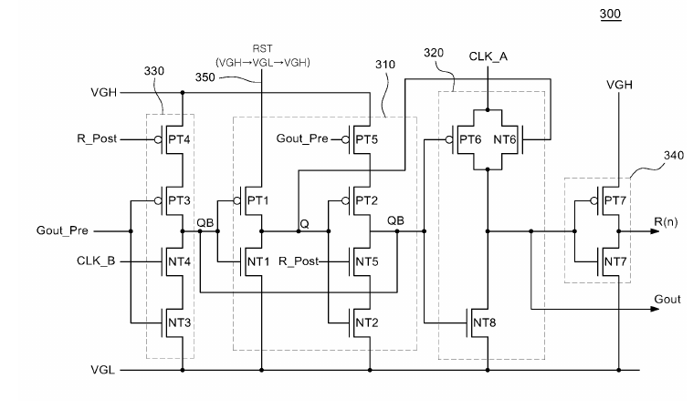

```{=html}
<style>
.cell-output-display img, figure img, .quarto-figure img { max-width:100% !important; height:auto !important; }
@media (max-width:640px){ .cell-output-display img, figure img { width:100%; } .figure-caption, figcaption { font-size:.82rem; } }
</style>
```

::: {.callout-note}
## 핵심 문장
특허의 “차단한다·유지한다·리셋한다”는 문장은 곧바로 소자 성능의 증명이 아니다. 같은 **명시된 합성 조건** 아래 회로를 재구성하고 원시 파형과 실패 행을 남기면, 그 문장은 반증 가능한 실험이 된다. 그리고 그 실험은 발명 회로가 **깨지는 경계**도 함께 보여 준다. 글리치가 제어 클록과 겹치거나 특허가 주장하지 않은 초기 소스 조건에서는 발명 회로도 실패했다.
:::

```{python}
import json
from pathlib import Path
import matplotlib.pyplot as plt
from matplotlib.patches import Patch

plt.rcParams["font.family"] = "Noto Sans CJK KR"
plt.rcParams["axes.unicode_minus"] = False
plt.rcParams["figure.dpi"] = 130
BLUE, GREEN, RED, GOLD, MUTED = "#38bdf8", "#22c55e", "#ef4444", "#f59e0b", "#64748b"
data = json.loads(Path("data/sp45_gip_benchmark.json").read_text())

def finish(ax, title, sub=""):
    ax.set_title(title, fontsize=13, fontweight="bold", loc="left", pad=14)
    ax.spines[["top", "right"]].set_visible(False)
    if sub: ax.text(0, 1.01, sub, transform=ax.transAxes, color=MUTED, fontsize=9)
```

# 왜 특허 문장만으로는 부족한가

특허는 회로의 구성과 효과를 언어로 쓴다. 그러나 “출력이 유지된다”는 문장에는 적어도 네 층이 섞여 있다. 어떤 회로를 비교 대상으로 삼았는가, 어떤 자극을 넣었는가, 어떤 전압을 통과선으로 삼았는가, 그리고 어느 모델을 썼는가다. 이 네 층이 빠지면 문장은 설계 의도이지 검증 결과가 아니다.

반대로 회로 시뮬레이션도 특허의 효과를 실측처럼 대신할 수 없다. 이 글은 여섯 특허 식별자를 출발점으로 만든 **연구용 회로 재구성**을 같은 합성 TFT 카드와 고정된 전원·타이밍 조건에서 비교한 기록이다. 따라서 여기서의 수치는 실제 패널, 특정 공정, 특허의 신규성·진보성을 판정하지 않는다.

# 한 조건에서 여섯 가지 동사를 시험하다

재구성 대상은 KR10-2017-0060953, KR10-2017-0071217, KR10-2017-0072514, KR10-2017-0072528, KR10-2017-0112036, EP2738758B1이다. 전부 공개 특허 식별자이지만, 회로 치수·일부 파형·모델 파라미터는 원문만으로 결정되지 않는다. 그래서 이 글은 절대 전압보다 **동일 가정 아래의 비교 차이**만 읽는다.

| 특허 식별자 | 재구성에서 본 수단 | 이 글의 증거 범위 |
|---|---|---|
| KR10-2017-0060953 | 클록-캐리 기반 리셋 | 단일 단계 5 측정점 |
| KR10-2017-0071217 | M7 클록 게이트 | 짝지은 비교 16행 + 발명 스트레스 16행 |
| KR10-2017-0072514 | RST 소스 초기화 | 구조·파형 초기화만 |
| KR10-2017-0072528 | T1/T2 세트·리셋 | 4단 자기 슬롯 |
| KR10-2017-0112036 | 다중 보호 경로 | 짝지은 비교 24행 + 발명 스트레스 8행 |
| EP2738758B1 | carry-게이트 분리 | 3 kΩ 결함 비교 |

## “분리한다”는 동사: 결함 앞의 carry

EP2738758B1에서 가져온 비교 질문은 단순하다. 게이트 라인에 3 kΩ 직렬 결함을 넣었을 때 carry가 어느 쪽에 남는가. 재구성된 분리 구조에서는 carry가 8.00 V, 비교 구조에서는 5.49 V였다. 여기서 6 V는 이 실험에서만 쓰인 판정선이며, 보편적인 GIP 규격이 아니다.

```{python}
#| label: fig-carry
#| fig-cap: "합성 조건의 3 kΩ 결함 비교. 막대는 재구성 회로의 원시 파형에서 집계한 carry와 gate-line의 대표 전압이며, 실측 소자값이 아니다."
c = data["carry"]
fig, ax = plt.subplots(figsize=(8.2, 4.2))
x = range(len(c)); w = .36
ax.bar([i-w/2 for i in x], [r["carry_v"] for r in c], w, label="carry", color=BLUE)
ax.bar([i+w/2 for i in x], [r["gate_v"] for r in c], w, label="gate line", color=GOLD)
ax.axhline(6, color=RED, ls="--", lw=1, label="이 실험의 6 V 판정선")
ax.set_xticks(list(x), [r["case"] for r in c]); ax.set_ylabel("V"); ax.set_ylim(0, 9)
ax.legend(frameon=False, ncol=3, fontsize=8); finish(ax, "결함은 gate를 낮췄지만, 분리된 carry는 이 조건에서 남았다")
plt.show()
```

이 차이는 “발명이 실제 제품에서 항상 더 낫다”가 아니라, **선언된 결함·모델·판정선의 조합에서** 회로 연결 방식이 다른 출력을 만들었다는 뜻이다. 측정이론의 언어로 말하면, 동사를 수치로 바꾼 것이 아니라 동사가 성립하는 관측 조건을 함께 적어 둔 것이다.

## “유지한다”는 동사: 실패 행을 세는 법

노이즈·초기 상태·글리치 조건마다 8개 슬롯(행)을 세었다. 시나리오는 두 종류다. **짝지은 비교**는 발명 회로와 종래(또는 특정 소자를 뺀) 회로를 같은 자극에 넣은 것이다. **스트레스 시험**은 발명 회로만 넣은 것인데, 글리치가 제어 클록과 겹치거나 특허 밖 초기 소스 조건을 쓴다.

```{python}
#| label: fig-failures
#| fig-cap: "사전에 선언한 모든 시나리오의 실패 행 수. 녹색은 짝지은 발명 회로, 금색은 발명 회로만 시험한 스트레스·특허 밖 조건, 적색은 짝지은 비교 회로다. 같은 회로의 독립 양산 표본이 아니므로 실패율을 수율로 읽으면 안 된다."
f = data["failure"]
fig, ax = plt.subplots(figsize=(9.2, 5.6))
h = .36
ys = list(range(len(f)))[::-1]
for yi, r in zip(ys, f):
    a = r["invention_fail"] / r["invention_total"] * 100
    ax.barh(yi + h/2, a, h, color=GREEN if r["group"] == "paired" else GOLD)
    ax.text(a + 1, yi + h/2, f'{r["invention_fail"]}/{r["invention_total"]}', va="center", fontsize=8)
    if r["comparison_fail"] is not None:
        b = r["comparison_fail"] / r["comparison_total"] * 100
        ax.barh(yi - h/2, b, h, color=RED)
        ax.text(b + 1, yi - h/2, f'{r["comparison_fail"]}/{r["comparison_total"]}', va="center", fontsize=8)
ax.set_yticks(ys, [f'{r["patent"].split("-")[-1]} · {r["scenario"]}' for r in f], fontsize=8)
ax.set_xlim(0, 112); ax.set_xlabel("실패율 (%)")
ax.legend(handles=[Patch(color=GREEN, label="짝지은 발명 회로"), Patch(color=RED, label="짝지은 비교 회로"),
                   Patch(color=GOLD, label="발명만 시험 (스트레스·특허 밖)")], frameon=False, fontsize=8, loc="lower right")
finish(ax, "짝지은 시나리오에서는 발명이 0 실패, 경계 조건에서는 발명도 실패")
plt.show()
```

**정정.** 이 글의 첫 판은 짝지은 비교 시나리오만 집계해 “발명 0/24 대 22/24”, “0/16 대 13/16”만 적었다. 이 판은 발명 회로를 넣은 모든 시나리오를 포함한다. 전체 발명 시험은 KR10-2017-0112036에서 8/32 실패, KR10-2017-0071217에서 13/40 실패다. 누락된 실패는 모두 CLK_B 겹침 또는 특허 밖 초기 소스 조건에서 나왔다.

짝지은 시나리오만 보면 차이는 일관된다. 그러나 그것만으로 발명이 강건하다고 말할 수 없다. 이 결과는 **특허가 명시한 타이밍·초기 조건 안에서** 종래 구성이 실패하고 발명 구성은 실패하지 않았다는 뜻이다. 그 밖의 조건에서는 발명도 실패한다.

## 파형으로 본 경계

아래 두 파형은 같은 재구성 회로가 두 조건에서 어떻게 달랐는지 보여 준다. 첫 그림은 4단 출력 중 글리치가 들어간 짝지은 발명 시나리오다. 행 펄스가 순서대로 올라가고, 글리치가 들어간 4단 구간에서도 Q4와 QB4가 뒤집히지 않았다.

{#fig-wave-ok fig-alt="발명 회로 파형, 글리치 억제 성공"}

두 번째 그림은 글리치가 CLK_B 펄스와 겹친 발명 시나리오다. 같은 회로인데도 여덟 행 모두에서 비정상 구간이 기록되었다. 이것이 이 글에서 가장 중요한 경계 결과다. 발명의 효과는 글리치가 제어 클록 위상과 어긋날 때 나타나고, 겹칠 때는 사라진다.

{#fig-wave-fail fig-alt="발명 회로 파형, CLK_B 겹침에서 실패"}

## 회로도: 어느 연결을 비교했는가

회로 재구성은 특허 도 3a 원도를 기준으로 넷리스트를 만들었다. 아래 그림은 원도 자체이며, 이 글은 이를 재구성의 기준 도면으로만 쓴다. 공개 특허 문서의 도면이므로 출처를 밝혀 둔다.

{#fig-circuit fig-alt="KR10-2017-0071217 특허 도 3a 회로도"}

# 경계에서 얻는 새 명제: 특허 해석은 실험 설계가 되고, 실험은 경계를 드러낸다

특허 해석과 시뮬레이션은 서로를 대체하지 않는다. 특허는 무엇을 비교해야 하는지 알려 주고, 시뮬레이션은 그 비교가 어떤 가정에 매달렸는지 드러낸다. 둘 사이에 측정이론을 넣으면, “효과”는 세 단계의 질문으로 바뀐다.

1. **구성:** 어떤 연결을 다르게 읽었는가?
2. **관측:** 어떤 결함·글리치·판정선을 걸었는가?
3. **반증:** 어느 위상·초기 상태·소스 조건에서 그 차이가 사라지는가?

이번 결과로 세 번째 질문의 답이 나왔다. 차이는 글리치가 제어 클록과 어긋날 때 나타났고, 겹칠 때와 특허가 주장하지 않은 소스 조건에서는 사라졌다. 이 틀의 장점은 특허를 법률 판단으로 과장하지 않으면서도, 문장을 회로 실험의 출발점으로 쓸 수 있다는 데 있다. 다음 실험의 목표는 더 많은 “통과”를 얻는 것이 아니라, 이 경계를 더 정밀하게 찾는 것이다.

::: {.callout-warning}
## 반대해석과 한계
- 모든 결과는 연구용 합성 TFT 모델, 단일 실행, 고정 전원·타이밍·부하 조건에 한정된다. HSPICE 일치, 상용 공정 일치, 실측 재현을 주장하지 않는다.
- 짝지은 비교만 보면 발명 회로가 더 강건하다. 그러나 발명 회로만 시험한 스트레스 조건에서는 실패가 나왔다. 이 둘을 합쳐서 읽어야 하며, 발명이 항상 더 낫다고 쓸 수 없다.
- 특허 원문만으로 회로 치수와 자극이 완전히 정해지지 않는 부분은 가정이다. 특히 KR10-2017-0072514와 KR10-2017-0072528은 구조 재현의 비중이 크다.
- 실패 행은 독립적인 양산 표본이 아니다. 실패율을 수율, 신뢰성, 통계적 일반화로 읽을 수 없고, 유의확률 검정은 이 글에서 쓰지 않는다.
- 0071217 S4의 “M3 소스=VGH” 시험은 특허가 주장하지 않는 조건이다. 실패를 특허의 결함으로 해석하지 않는다. 설계 경계를 보여 주는 참고 자료일 뿐이다.
- 이 글은 특허의 유효성·침해·신규성·진보성에 관한 의견이 아니다.
:::

# 재현 자료와 참고 문헌

이 글의 집계값은 `output/data/sp45_gip_benchmark.json`에 공개했다. 시나리오별 행 수(8슬롯 기준)는 두 재구성의 `results.json`과 `results2.json`에서 옮겼다. 차트와 파형 그림은 같은 시뮬레이션 출력에서 만든 원시 그림이다.

1. Google Patents, [KR10-2017-0060953](https://patents.google.com/?q=KR1020170060953), [KR10-2017-0071217](https://patents.google.com/?q=KR1020170071217), [KR10-2017-0072514](https://patents.google.com/?q=KR1020170072514), [KR10-2017-0072528](https://patents.google.com/?q=KR1020170072528), [KR10-2017-0112036](https://patents.google.com/?q=KR1020170112036), [EP2738758B1](https://patents.google.com/patent/EP2738758B1).
2. 연구 재현 자료: Insight Lab, `sp45_gip_benchmark.json` (2026-10-29).
