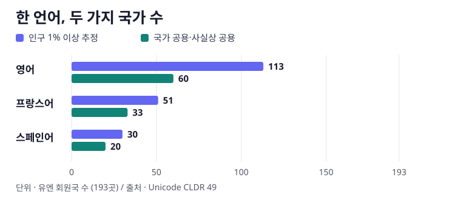

[← Insight Lab · 에피소드 목록](../index.html)

::: {.callout-note}
## 핵심 문장

세종은 혀와 입술의 움직임을 글자 모양에 담았다. 몇 세기 뒤 제국의 국경이 사라진 자리에서는, 같은 프랑스어가 세네갈의 공용어로 남았고 알제리에서는 국가 공용 지위를 얻지 못했다. 지도에서 이 차이를 읽으려면 **어떤 말을 쓰는가, 무엇으로 적는가, 어느 제도가 그 말을 쓰는가**를 따로 물어야 한다.
:::

# 세종이 바꾼 것은 말을 적는 방법이었다

> 나랏말ᄊᆞ미 中國에 달아

오늘날 말로 풀면, 우리나라 말이 중국과 달라 한자로는 사람들이 하고 싶은 말을 적기 어렵다는 뜻이다. 세종은 쉽게 익혀 날마다 쓸 수 있는 글자를 만들고자 했다. 《세종실록》 세종 25년 음력 12월 기사는 임금이 직접 28자를 지었다고 기록한다. 1443년의 창제 기록과 1446년 음력 9월의 반포는 다른 사건이다. 위 인용은 세종의 서문을 한글로 옮긴 언해본의 첫 구절이다. [세종실록](https://sillok.history.go.kr/id/wda_12512030_002) · [유네스코 해례본 기록](https://www.unesco.org/en/memory-world/hunminjeongum-manuscript) · [국립한글박물관](https://m.hangeul.go.kr/lang/en/html/education/Hangeul.do)

해례본에서 **ㄱ**은 혀뿌리가 목구멍 쪽을 막는 모습을, **ㄴ**은 혀가 윗잇몸 쪽에 닿는 모습을, **ㅁ**은 입의 모양을 본뜬다. 모음은 **ㆍ, ㅡ, ㅣ**를 하늘·땅·사람에 대응시켜 설명한다. 그리고 초성·중성·종성을 묶어 ‘한’ 같은 음절을 쓴다. 해례의 조음 설명, 글자 모양, 음절을 조립하는 규칙이 한 문서 안에서 서로 맞물리는 지점이다. 15세기 자모의 소리는 현대 한국어와 다른 부분이 있으므로, 조음 실험실의 옛소리 시연은 당시의 소리를 재구성한 예시로 읽어야 한다. [국립한글박물관의 창제 원리](https://m.hangeul.go.kr/lang/en/html/education/Hangeul.do) · [한국학중앙연구원 음운 해설](https://www.aks.ac.kr/ikorea/upload/intl/korean/UserFiles/UKS1_Hangeul_eng.pdf)

실록에는 옛 전자(篆字)를 모방했다는 구절도 있다. 이는 글자 모양의 기원을 논의하는 사료다. 한글이 만들어지기 전에도 한국어는 쓰였고, 한자를 이용해 한국어를 적는 관행도 있었다. **한국어의 계통**, **한국어를 적던 방법**, **훈민정음 자형의 기원**은 각각 다른 증거로 다뤄야 한다. [실록의 창제 기사](https://sillok.history.go.kr/id/wda_12512030_002) · [한글 이전 표기와 기원설 해설](https://waterfirst.github.io/King-Sejong-s-utterances/research.html#origins)

[조음 실험실에서 혀·입술·성대 시연 보기 →](https://waterfirst.github.io/King-Sejong-s-utterances/)

# 편지에서 사전까지, 글자는 누가 이어 썼나

군관 나신걸은 멀리서 아내 신창 맹씨에게 농사일을 챙기고 옷을 보내 달라는 말을 한글 편지에 적었다. 15세기 말로 추정하는 이 편지에서 새 문자는 왕실의 설명서 밖으로 나와 가족의 일에 쓰인다. 조선 후기에는 한글 소설과 편지가 독자의 범위를 넓혔다. 책에 실린 규칙이 개인의 손을 거쳐 생활 속 기록이 된 것이다. [국가유산포털 나신걸 한글편지](https://digital.khs.go.kr/heri/heriDetail.do?ctptNo=1122522090000&ctptUid=13983497296741002592) · [국립한글박물관 한글 소설](https://www.hangeul.go.kr/webzine/202209/sub3_2.html)

1877년 존 로스는 한국어 교사 이응찬의 도움을 받아 《조선어 첫걸음》을 만들었다. 현존하는 이 교재의 띄어쓰기와 1896년 《독립신문》의 띄어쓰기는 글자 자체를 발명한 뒤에도 문장에 경계를 놓는 관행이 바뀌었음을 보여 준다. 식민지 시기에는 조선어학회가 1933년 맞춤법 통일안을 마련했고, 1942년 회원들이 체포되면서 사전 편찬이 중단됐다. 광복 후 이어진 편찬은 1957년 《큰사전》 완간으로 결실을 맺었다. [존 로스와 이응찬](https://www.hangeul.go.kr/webzine/201702/sub2.html) · [조선어학회와 맞춤법](https://www.hangeul.go.kr/webzine/202603/sub1_1.html) · [큰사전 원고와 완간](https://www.hangeul.go.kr/webzine/201908/sub1_3.html)

오늘날에는 K팝 노랫말과 드라마 대사가 한국어 학습으로 이어지는 계기가 된다. 교육부의 2025년 기준 자료에서 **현지 초·중·고 한국어 교육이 이뤄진 곳은 47곳**, **한국어를 제2외국어로 정식 채택한 곳은 24곳**이었다. 콘텐츠를 접한 사람, 수업을 운영하는 학교, 정규 교과로 채택한 교육 제도는 서로 다른 단위다. [교육부 해외 한국어교육 보급 현황 · 붙임 3](https://www.moe.go.kr/boardCnts/viewRenew.do?boardID=294&boardSeq=105271&m=020402&s=moe) · [국립한글박물관 한류와 한글](https://www.hangeul.go.kr/webzine/202603/sub1_1.html) · [한국어 교육 지도와 사료 갤러리](https://waterfirst.github.io/King-Sejong-s-utterances/#world-title)

# 세계 지도는 같은 색으로 다른 사실을 말한다

캐나다에서 영어를 고르면 나라가 칠해진다. 프랑스어를 골라도 캐나다가 칠해진다. **라틴 문자**를 고른 뒤 캐나다를 누르면 영어와 프랑스어가 함께 나온다. 언어 지도는 인구 비중이나 공용 지위를, 문자 지도는 국가 공용·사실상 공용 언어의 대표 표기를 표시한다. 나라 하나가 여러 항목에 들어갈 수 있으므로 지도는 항목을 한 번에 하나씩 보여 준다. [대화형 언어·문자 지도](https://waterfirst.github.io/King-Sejong-s-utterances/atlas.html#distribution) · [Unicode CLDR의 인구·공용 지위 정의](https://unicode.org/reports/tr35/tr35-info.html#Territory_Information)

{fig-alt="영어 113곳과 60곳, 프랑스어 51곳과 33곳, 스페인어 30곳과 20곳. 두 기준은 별도 집계이며 서로 포함 관계를 뜻하지 않는다."}

| 언어 | 인구 1% 이상 추정 | 국가 공용·사실상 공용 |
|---|---:|---:|
| 영어 | 113곳 | 60곳 |
| 프랑스어 | 51곳 | 33곳 |
| 스페인어 | 30곳 | 20곳 |

두 열은 CLDR 49를 유엔 회원국 193곳에 적용한 별도 집계다. 첫째 열은 기능적 언어 사용 추정치, 둘째 열은 중앙정부 소통에서의 공용 지위를 바탕으로 한다. 두 기준에 해당하는 국가 목록은 일부 겹친다. 여기서 한국어의 교육과정 채택 24곳은 별도의 교육부 집계다. 세계 화자 수에서는 2026년 추정 기준 모어·제2언어를 합친 영어가 약 14.9억 명이고, 모어만 보면 관화가 약 9.88억 명으로 가장 많다. **화자 수의 분모는 사람이고, 이 지도의 분모는 국가다.** [CLDR 49 원자료](https://github.com/unicode-org/cldr-json/blob/49.0.0/cldr-json/cldr-core/supplemental/territoryInfo.json) · [유엔 회원국](https://www.un.org/en/about-us/member-states) · [Ethnologue 2026 방법](https://shop.ethnologue.com/products/2026-ethnologue-200) · [공개 화자 수](https://qz.com/most-spoken-languages-in-the-world-2026)

# 독립은 같은 날에 여러 층에서 일어나지 않는다

| 과거 통치국 | 독립의 경로 | 현재 전 제국 언어의 공적 지위 |
|---|---|---|
| 영국 | 인도, 1947년 분할과 독립 | 영어는 힌디어와 함께 연방 공무와 의회에 사용된다. [인도 공용어법 제3조](https://www.indiacode.nic.in/bitstream/123456789/1526/1/A1963__19.pdf) |
| 프랑스 | 세네갈, 1960년 말리연방 독립과 분리 | 프랑스어가 공용어다. 월로프어 등은 헌법이 인정하는 민족 언어다. [세네갈 정부 헌법 제1조](https://primature.sn/publications/lois-et-reglements/loi-ndeg-2001-03-du-22-janvier-2001-portant-constitution-modifiee) |
| 프랑스 | 알제리, 1962년 독립 | 국가 공용어는 아랍어와 타마지그트어다. 프랑스어는 일부 도시 등에서 사회적으로 쓰인다. [알제리 헌법 제3·4조](https://www.wipo.int/wipolex/fr/legislation/details/20552) · [언어 사용 연구](https://asjp.cerist.dz/en/downArticle/326/11/4/252345) |
| 일본 | 한반도, 1945년 광복. 대한민국, 1948년 정부 수립 | 대한민국의 공용어는 한국어다. [국가기록원](https://theme.archives.go.kr/next/gazette/viewIntroduction03.do) · [국어기본법](https://www.law.go.kr/lsInfoP.do?lsId=009877&urlMode=lsInfoP) |

세네갈과 알제리는 같은 제국에서 벗어났지만 프랑스어의 공적 지위는 달라졌다. 알제리에서 헌법의 공용어 조항을 읽는 것과 도시에서 사람들이 주고받는 말을 조사하는 것은 별개의 일이다. 인도의 법에는 영어가 계속 쓰이는 기관이 적혀 있다. 이 사례들을 같은 지도에 올리면, **독립 연도만으로는 어떤 언어가 공문서와 교실, 일상에서 이어졌는지 설명할 수 없다**는 점이 드러난다. 대표 사례 12건의 지도에서는 독립 경로와 중앙정부의 언어 지위를 함께 확인할 수 있다. [독립 이후 언어 지도와 사례별 사료](https://waterfirst.github.io/King-Sejong-s-utterances/atlas.html#colonies)

# AI의 언어 지도에는 또 다른 기준이 필요하다

한글의 조합 규칙은 컴퓨터에서도 그대로 쓸 수 있다. 유니코드는 한글 음절을 자모로 분해하고 다시 합치는 규칙을 제공한다. Cognetta 등의 영한 뉴스 번역 실험은 그 구조를 이용해 한국어 임베딩·출력층의 매개변수를 1,140만 개에서 3만 6천 개로 줄였고, 두 비교 설정의 BLEU는 14.1과 14.0이었다. 이 수치는 **한국어 임베딩·출력층**과 해당 번역 실험의 결과다. [유니코드 한글 조합·분해](https://www.unicode.org/versions/Unicode17.0.0/core-spec/chapter-3/) · [Cognetta 등, EACL 2023 표 2](https://aclanthology.org/2023.eacl-main.172/)

그러나 토큰을 저장하는 방법이 효율적이어도 학습 자료와 평가에는 또 다른 선택이 남는다. 2020년 GPT-3가 공개한 데이터는 단어 수 기준 영어가 92.65%였다. 한편 GPT와 중국에서 개발한 ERNIE를 비교한 실험에서는 같은 모델도 영어로 물을 때와 중국어로 물을 때 문화적 표현이 달라졌다. 어느 언어로 자료를 모았는지, 어느 언어로 질문하는지, 어떤 지식을 문제로 냈는지를 기록해야 이 차이를 설명할 수 있다. 한국어 원문 시험을 모은 KMMLU가 별도로 필요한 이유도 여기에 있다. [GPT-3 공개 데이터](https://github.com/openai/gpt-3/blob/master/dataset_statistics/languages_by_word_count.csv) · [GPT·ERNIE 문화 비교](https://doi.org/10.1038/s41562-025-02242-1) · [KMMLU 원문](https://aclanthology.org/2025.naacl-long.206/)

훈민정음 해례는 자형을 보고 소리를 어떻게 적었는지 거슬러 읽을 수 있게 했다. 언어 지도와 AI 평가에도 그와 비슷한 설명이 필요하다. 캐나다가 칠해졌다면 인구 비중인지 공용 지위인지 묻고, 한글 토큰이 줄었다면 어휘표인지 문장 길이인지 묻는다. 색 하나와 숫자 하나를 해석하는 데 필요한 것은, 그것을 만든 규칙이다.

- [한국어 AI 논문 다섯 편과 도해](https://waterfirst.github.io/King-Sejong-s-utterances/ai-research.html)
- [미국·중국 모델 비교와 다국어 성능 그래프](https://waterfirst.github.io/King-Sejong-s-utterances/language-bias.html)
