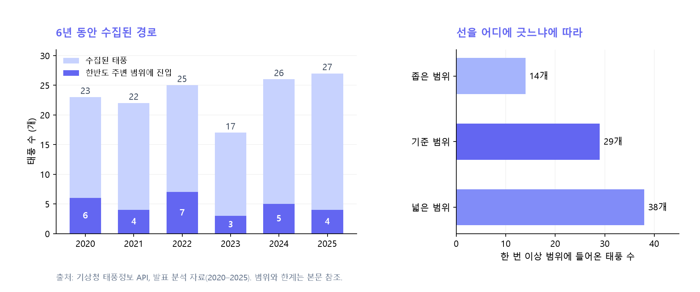
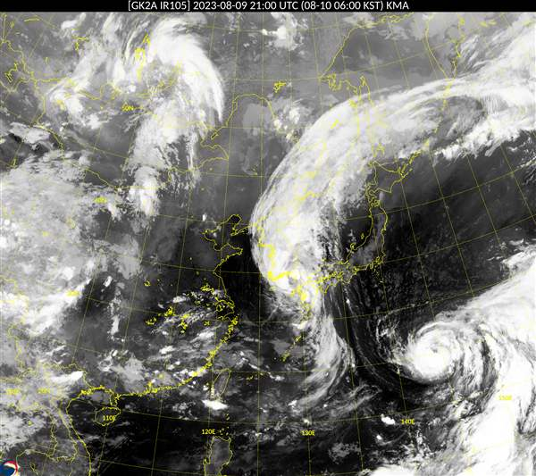
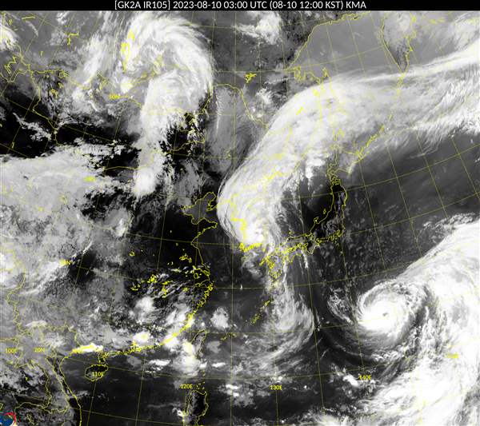

::: {.callout-note}
## 핵심 문장

2020–2025년 기상청 발표 분석자료에서 수집한 태풍 경로는 140개다. 그중 29개에 한반도 주변에 임의로 그은 넓은 상자(북위 30–42°, 동경 120–135°) 안의 관측점이 적어도 하나 있다. 상자를 좁히면 14개, 넓히면 38개다. **한반도의 위치는 고정돼 있지만, ‘주변을 지났다’는 숫자는 우리가 선택한 경계에 따라 달라진다.** 어느 숫자도 기상청이 판정한 ‘우리나라 영향 태풍’의 수나 실제 상륙 횟수가 아니다.
:::

# 질문: 한반도는 태풍의 길목인가

고등학교 과학 교과서는 기상 데이터를 활용하라고 말한다. 그러나 무엇을 묻고, 어떤 자료를 골라, 결과를 어디까지 말할 수 있는지는 설명하기 어렵다. 이 글은 그 빈칸을 한 가지 사례로 채운다. **한반도의 지리적 위치가 태풍의 이동과 어떤 관계가 있으며, 기상청 API와 AI로 그 질문을 어떻게 탐구할 수 있을까?**

한반도는 동아시아 대륙 동쪽에 자리하고 남쪽과 동쪽이 바다에 면한다. 북서태평양에서 발달한 태풍 가운데 일부는 대기 흐름을 따라 북상해 한반도와 주변 해역에 접근한다. 위치는 태풍과 만날 가능성을 설명하는 출발점이다. 그러나 한반도가 태풍을 끌어당기는 것은 아니다. 태풍은 주변 대기의 바람과 기압계에 영향을 받으며 이동한다. 북태평양 고기압의 위치·세력, 중위도 기압골과 편서풍, 태풍 자체의 상태에 따라 진로와 전향 시점이 달라진다. [기상청 『2025 태풍백서』](https://www.kma.go.kr/download_01/typhoon/typwhitebook_2025.pdf)는 태풍의 전향을 북태평양 고기압과 주변 대기 흐름의 관계 속에서 설명한다.

따라서 ‘태풍의 길목’은 통계와 대기 흐름을 요약하는 말이지 정해진 고속도로가 아니다. 같은 장소도 태풍마다 서쪽·동쪽·중심 경로의 다른 위치에 놓인다. 중심이 지나간 선만으로 강풍, 호우, 피해 범위를 모두 알 수는 없다.

# 여섯 해의 지도: 선을 어디에 긋느냐

이 글은 앞서 제작한 [태풍 경로 탐구 웹앱](https://waterfirst.github.io/Taepoong_trajectory/?v=sp50)을 연구 도구로 사용한다. 자료는 기상청 API허브의 **태풍목록**과 **태풍정보+예측**에서 받았다. 태풍마다 `mode=0`의 발표 분석자료를 사용하고 `FT=0`인 행의 시각과 위도·경도를 읽었다. 해당 시각의 중심 위치가 범위 안에 한 번 이상 있으면 그 태풍을 한 번 센다. 한 태풍이 범위 안에서 열 번 관측돼도 한 개다.

이 기준은 연구자가 임의로 정한 **직사각형 안의 관측점**이다. 육지를 지났는지, 중심과 한 지점 사이의 거리가 몇 km인지, 해당 태풍이 우리나라에 공식적으로 영향을 미쳤는지는 판정하지 않는다. [기상청 API 명세](https://apihub.kma.go.kr/apiList.do?seqApi=8)의 `FT`, `LAT`, `LON`, `FT_TM` 정의와 자료 제공 조건을 확인할 수 있다.

| 태풍 발생 연도 | 수집한 경로 | 기준 상자에 관측점이 있는 태풍 | 비율 |
|---|---:|---:|---:|
| 2020 | 23 | 6 | 26.1% |
| 2021 | 22 | 4 | 18.2% |
| 2022 | 25 | 7 | 28.0% |
| 2023 | 17 | 3 | 17.6% |
| 2024 | 26 | 5 | 19.2% |
| 2025 | 27 | 4 | 14.8% |
| **합계** | **140** | **29** | **20.7%** |

범위에 들어온 태풍 29개 중 **처음 들어온 관측점**이 8월 또는 9월에 나타난 것은 20개다. 이는 이 자료에서 확인되는 계절적 집중이다. 여섯 해의 자료만으로 장기 추세나 기후변화의 원인을 판정할 수는 없다.

{#fig-counts}

같은 관측점을 놓고 상자만 바꿔 보자.

| 정의 | 위도 | 경도 | 한 번 이상 관측된 태풍 |
|---|---|---|---:|
| 좁은 범위 | 북위 32–40° | 동경 124–132° | 14개 |
| 기준 범위 | 북위 30–42° | 동경 120–135° | 29개 |
| 넓은 범위 | 북위 28–44° | 동경 118–137° | 38개 |

세 범위는 모두 교육용 비교 장치다. 좁은 범위도 바다와 이웃 지역을 포함하며, 관측점이 한반도 육지 안에 있다는 뜻이 아니다. 연속된 두 관측점이 상자 바깥에 있더라도 그 사이의 실제 경로가 상자를 지났을 가능성이 있다. 반대로 상자에 한 점이 있다고 그 태풍이 대한민국에 영향을 줬다고 단정할 수 없다. **경계를 바꾸는 실험은 정답을 고르는 검사가 아니라, 질문의 정의가 결론에 주는 영향을 확인하는 검사다.**

::: {.callout-tip}
## 직접 확인하기

[태풍 경로 탐구 웹앱 열기](https://waterfirst.github.io/Taepoong_trajectory/?v=sp50)

‘선택 연도 전체 경로 보기’ 또는 ‘2020~2025 전체 경로 비교’를 눌러 보자. 선은 중심의 발표 분석 위치를 이은 것이며, 위성영상은 한반도 주변에 해당하는 시각에 수집된 경우에만 표시된다. 위성사진의 실제 촬영시각을 지도 시각과 비교하자.
:::

# 두 태풍: 같은 위치, 다른 길

## 힌남노: 지그재그 끝의 남동해안

2022년 제11호 태풍 힌남노는 북쪽으로만 움직인 것이 아니다. 기상청 분석에 따르면 발생 뒤 서쪽과 남서쪽으로 이동하고, 오키나와 남쪽에서 정체한 뒤 북상했다. 9월 5일에는 중위도 대기 흐름의 영향을 받아 이동이 빨라졌고, **9월 6일 오전 4시 50분경 거제 동쪽에 상륙**했다. [기상청 2022년 태풍 영향 분석](https://www.kma.go.kr/download_01/typhoon/typeffect_2022.pdf)

웹앱 자료에서 2022년 9월 5일 21:00 UTC의 중심 좌표는 북위 35.2°, 동경 129.2°다. 한국시간으로는 **9월 6일 06:00 KST**다. 상륙 시각과 위치는 연속적인 현상을 세 시간 간격 등의 발표점으로 요약한 경로만으로 정확히 정할 수 없으므로, 공식 분석에서 확인했다. 지도 점과 공식 상륙시각을 섞어 같은 종류의 관측치처럼 다루지 않는 것이 중요하다.

## 카눈: 한반도를 남북으로

2023년 제6호 태풍 카눈은 방향을 여러 차례 바꾼 뒤 8월 10일 오전 거제 부근에 상륙해 한반도를 남북으로 통과했다. 기상청은 카눈이 중국·일본·한국 쪽으로 진로를 바꾸면서 예측의 불확실성이 컸다고 설명한다. [기상청 2023 예보평가 보고서](https://www.kma.go.kr/download_01/forecast_report/report_2023.pdf), [2023 태풍분석 보고서](https://www.kma.go.kr/download_01/typhoon/typreport_2023.pdf)

두 사례에서 한반도의 좌표는 바뀌지 않는다. 달라지는 것은 태풍이 만나는 대기의 배치와 이동 과정이다. 같은 ‘한반도 접근’이라도 중심의 위치, 이동속도와 방향, 비구름·바람의 분포에 따라 지역별 경험은 달라진다. 이 차이를 보여 주는 것이 경로의 가치다. 다만 피해의 차이를 실제로 설명하려면 강수·풍속·지형·노출 자료를 별도로 결합해야 한다.

# 사진이 보여 주는 것과 보여 주지 않는 것

다음은 태풍 카눈이 한반도 남해안에 접근하고 통과하던 날의 실제 위성영상이다. 두 영상은 같은 동아시아 영역을 **6시간 간격**으로 담았다. 왼쪽은 상륙 전인 2023년 8월 10일 06:00 KST, 오른쪽은 상륙 후인 12:00 KST다. 영상에서 한반도 주변 구름의 분포가 어떻게 달라지는지 살펴보자. 화면 오른쪽 아래의 또 다른 소용돌이를 카눈으로 혼동하지 않도록 지도와 관측 시각을 함께 확인해야 한다.

::: {layout-ncol="2"}
{#fig-sat-before}

{#fig-sat-after}
:::

웹앱의 천리안 2A호 영상은 **동아시아 영역 적외영상(IR105)**이다. 태풍이 화면 한가운데에 오도록 자동 추적한 사진이 아니다. 화면의 밝기는 적외 관측값을 영상으로 표현한 것이어서 사람이 눈으로 보는 자연색 사진도 아니다. 태풍 중심이 교육용 상자 안에 있는 시각에 수집된 영상만 연결한다. 동일 태풍이라도 해당 시각의 파일이 없으면 표시할 수 없다.

위성영상과 태풍 경로는 별개의 관측·분석 자료다. 경로 재생 중에는 확보한 사진 중 가까운 시각을 보여 주므로 **지도 시각과 사진 시각이 같지 않을 수 있다.** 화면에 적힌 두 시각을 비교해야 한다. [국가기상위성센터 자료 활용 안내](https://datasvc.nmsc.kma.go.kr/resources/common/pdf/%EC%B2%9C%EB%A6%AC%EC%95%88%EC%9C%84%EC%84%B1%202A%ED%98%B8%20%20%EC%9E%90%EB%A3%8C%ED%99%9C%EC%9A%A9%20QA.pdf)는 동아시아·한반도·전구 영상의 관측 영역과 주기를 구분한다.

‘AWS’도 구분해야 한다. 기상청의 **방재기상관측(AWS)**은 지상 관측장비가 기온·강수·바람 등을 관측하는 자료다. 위성영상이 아니다. 한반도 접근 전후의 실제 강수나 풍속을 지역별로 비교하는 후속 연구에는 AWS를 이용할 수 있지만, 이 글의 경로·위성사진 그래프가 AWS에서 나온 것은 아니다.

# 수업에서 직접 만들기: API와 AI의 역할

1. **질문을 정한다.** 예를 들어 ‘2020–2025년 발표 경로 중 북위 30–42°, 동경 120–135°에 중심이 한 번 이상 들어온 태풍은 연도별로 몇 개인가?’처럼 기간과 기준을 먼저 쓴다.
2. **자료를 찾는다.** [날씨마루](https://bd.kma.go.kr/kma2020/svc/main.do)는 기상기후 자료와 분석환경을 살펴보는 곳이다. 별도로 [기상청 API허브](https://apihub.kma.go.kr/)에서 계정을 만들고 인증키를 발급받아 태풍목록과 태풍정보+예측의 활용신청을 한다. 위성영상도 쓰려면 천리안 2A호 기본관측 이미지 API를 별도로 신청한다. 메뉴와 승인 절차는 사이트 안내를 확인한다.
3. **AI에 코드를 요청한다.** ‘`FT=0`인 태풍 분석자료의 시간·위도·경도를 읽어 지도에 표시하고, 같은 태풍을 여러 관측점에서 세더라도 한 번만 세어 줘. UTC를 한국시간으로 변환하고, 비어 있는 자료는 따로 알려 줘’라고 구체적으로 요청한다. 인증키는 AI 대화나 공개 저장소에 넣지 않는다.
4. **한 줄을 손으로 대조한다.** 힌남노의 `202209052100` UTC는 한국시간으로 9월 6일 06:00이다. 원본 좌표와 웹앱의 점이 같은지, 태풍을 한 번만 셌는지 확인한다.
5. **결론을 흔든다.** 범위를 좁고 넓게 다시 정해 결과를 비교하고, 그 차이가 공식 영향 태풍 수와 다른 이유를 토의한다. AI가 쓴 설명은 원자료와 기상청의 해설로 검증한다.

::: {.callout-warning}
## 한계와 이 해석이 달라지는 조건

- **여섯 해의 표본:** 연도별 차이는 보이지만 기후변화에 따른 증가·감소 추세를 추론할 근거는 부족하다.
- **발표 분석자료:** 이 자료는 발표 당시 분석을 모은 것이며 사후 재분석한 베스트트랙과 다를 수 있다. API가 반환한 경로를 사용했으므로 전 기간·전 현상을 완전하게 포괄한다고 주장하지 않는다.
- **점과 선:** 시간 간격이 있는 관측점 중 하나가 상자 안에 있는지만 셌다. 관측점 사이의 통과나 육지 상륙을 판정하지 않는다.
- **영향과 거리:** 중심이 상자 밖이어도 비바람과 너울은 한반도에 영향을 줄 수 있다. 반대로 상자 안의 점이 실제 피해를 뜻하지 않는다.
- **영상의 범위:** 동아시아 고정 영역과 몇 개의 영상 시각만 사용한다. 태풍의 눈이 화면에 나타난다는 보장은 없다.
- **비교의 불확실성:** 상자 경계, 자료 보유 시기, 관측 간격을 바꾸면 숫자가 바뀐다. 강수·풍속·인구 노출을 결합하기 전에는 위험도나 피해 추세를 계산한 것이 아니다.
:::

# 맺음말: 지리는 운명이 아니라 질문의 좌표다

한반도는 북서태평양 태풍과 만날 수 있는 위치에 있지만, 그 위치만으로 특정 태풍의 경로나 피해가 정해지지는 않는다. 지도는 접근을 보여 주고, 대기역학은 왜 경로가 달라졌는지 묻도록 한다. 위성영상은 같은 시간을 다른 관측 방식으로 보여 준다.

API와 AI가 하는 가장 유용한 일은 수업을 ‘정답을 쓰는 과제’에서 **기준을 바꾸고 다시 세어 보는 탐구**로 확장하는 것이다. 숫자를 낸 뒤에는 무엇을 세었는지, 무엇을 세지 않았는지를 학생이 직접 설명해야 한다.

# 자료와 재현

- 기상청 API허브, [태풍정보(기상청 발표) 조회](https://apihub.kma.go.kr/apiList.do?seqApi=8): `typ_lst.php`, `typ_data.php`, `mode=0`. 관측시각은 UTC.
- 기상청 API허브, [천리안 2A호 자료조회](https://apihub.kma.go.kr/apiList.do?seqApi=6): 동아시아(EA) IR105 위성영상.
- 기상청, [2022년 태풍 영향 분석](https://www.kma.go.kr/download_01/typhoon/typeffect_2022.pdf); [2023 태풍분석 보고서](https://www.kma.go.kr/download_01/typhoon/typreport_2023.pdf); [2025 태풍백서](https://www.kma.go.kr/download_01/typhoon/typwhitebook_2025.pdf).
- 기상청, [2023 예보평가 보고서](https://www.kma.go.kr/download_01/forecast_report/report_2023.pdf).
- 데이터 스냅샷: [태풍 경로 웹앱 저장소의 연도별 JSON](https://github.com/waterfirst/Taepoong_trajectory/tree/f7e3bccb4ab68810bfe6cfc2568ad5904c3ba69c/public/data), 2026-11-08 분석. API 인증키는 포함하지 않았다.
- [집계 재현 코드](sp50_reproduce.py): 공개 스냅샷에서 연도별 경로를 읽어 세 범위와 첫 진입 달을 다시 계산한다.
- 방법: 각 연도 JSON의 `tracks`를 태풍 단위로 읽고 `FT=0` 관측점이 각 사각 범위에 하나 이상 있으면 1개로 센다. 결측·비정상 좌표는 범위 밖으로 처리한다. 비율은 각 연도의 수집 경로 수를 분모로 계산했다.

